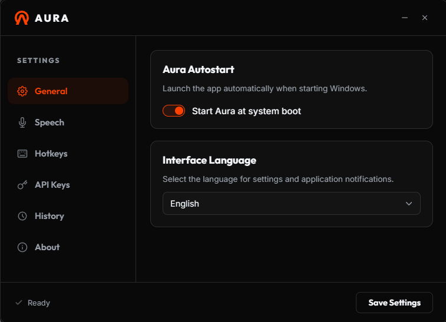

<p align="center">
  
</p>

<h1 align="center">Aura — голосовой ввод для Windows</h1>

<p align="center">
  <b>Мгновенная офлайн и облачная голосовая печать прямо под курсором.</b><br />
  <a href="https://aura-beryl-five.vercel.app/">🌐 Официальный сайт и веб-демо</a>
</p>

<p align="center">
  <a href="https://github.com/malashkadev/aura/actions/workflows/ci.yml"></a>
  <a href="https://github.com/malashkadev/aura/releases"></a>
  <a href="https://sourceforge.net/projects/aura-voice-typing/files/latest/download"></a>
  <a href="LICENSE"></a>
  
</p>

> 🇬🇧 [English documentation](README.md)

Зажмите горячую клавишу, надиктуйте текст и отпустите — Aura мгновенно расшифрует речь и напечатает готовый текст прямо под курсором в **любом** приложении Windows. Работает полностью автономно на локальных моделях (Whisper, NVIDIA Parakeet с CUDA-ускорением на GPU) или подключается к облачным сервисам (Gemini, Groq, OpenAI, Hugging Face, Custom API).

**100% бесплатно и с открытым исходным кодом (AGPL-3.0)** — без подписок, скрытых ограничений, встроенной рекламы и телеметрии.

<p align="center">
  
  
</p>

## Возможности

- **Диктовка по глобальной горячей клавише** — удерживайте для записи (`Alt+V`) или включите режим переключателя (короткое нажатие); отмена по `Esc`.
- **Два режима распознавания**:
  - **Локальный (100% офлайн и приватно)** — whisper.cpp или NVIDIA Parakeet TDT v3 (sherpa-onnx) на CPU или GPU NVIDIA CUDA. Звук не покидает ваш компьютер; скачивайте модели в один клик прямо из настроек.
  - **Облачный** — Google Gemini, Groq, OpenAI, Hugging Face или собственный OpenAI-совместимый сервер.
- **Аппаратное ускорение NVIDIA CUDA** — поддержка GPU для моделей Whisper и Parakeet с автоматической загрузкой runtime-библиотек в один клик и безопасным переключением на CPU при необходимости.
- **Игровой режим (Gaming Mode)** — автоопределение 3D-приложений (DirectX / Vulkan) с приостановкой перехвата клавиш и выгрузкой моделей для максимального FPS, а также быстрым ручным переключением через меню в трее.
- **Выгрузка VRAM при бездействии (Сон)** — настраиваемый таймер сна (15, 30, 60 минут) для освобождения видеопамяти без закрытия программы.
- **Мгновенный потоковый ввод** — стабильный пословный ввод текста в реальном времени без мерцания и дублирования (NVIDIA Parakeet).
- **Автозамена и динамические макросы** — локальные правила замены надиктованных слов на шаблоны, адреса или динамические токены даты и времени (`{date}`, `{date_ru}`, `{time}`, `{datetime}`). Символ `|` в шаблоне задаёт позицию курсора после вставки (напр. `Здравствуйте, |!`).
- **Защита фокуса (Focus Guard) и контекстное редактирование** — защищает от ввода в чужие окна при случайной смене фокуса (с безопасным переносом текста в буфер обмена) и позволяет быстро редактировать выделенный фрагмент с янтарной подсветкой контура целевого поля.
- **Выбор микрофона, WASAPI Hotplug и защита от обрыва фраз** — переключение устройства ввода, автоопределение подключения/отключения гарнитур, 450-мс буфер удержания звука и недеструктивный Silero VAD.
- **История транскрипций с группировкой по дням** — до 300 зашифрованных записей (DPAPI) с разделением на «Сегодня» / «Вчера» / даты, живым поиском и фильтрацией по источникам.
- **Собственный словарь** — подсказка специфических имён, брендов и технических терминов для безошибочного написания.
- **12 вариантов языка** — автоопределение, привязка к текущей раскладке клавиатуры или фиксированный выбор (ru, en, de, es, fr, it, zh, pt, tr, nl).
- **Компактный оверлей и 6 звуковых тем** — индикация уровня микрофона, таймер записи, звуковые темы (Дзен, Rhodes, Sci-Fi, Колокольчик, Капля воды, Тактильный свитч) и гибкая настройка отображения.
- **Нативное трей-меню с поддержкой High-DPI** — быстрое переключение игрового режима, вызов настроек и выход с точным позиционированием на мультимониторных системах.
- **Системная интеграция и безопасность** — автозапуск с Windows, системное шифрование ключей (DPAPI), встроенная выгрузка диагностического отчёта с заменой пути профиля и переносимая резервная копия настроек с выбором места сохранения (API-ключи не экспортируются).
- **Помощь при первом запуске** — если локальная модель не установлена, вкладка «Основные» предлагает скачать Base и проверить микрофон в один клик.

## Сравнение

Aura сочетает автономную скорость локальных нейросетей, поддержку GPU-ускорения и гибкость подключения облачных сервисов.

| Параметр | **Aura** | **Handy** | **Wispr Flow** |
|---|---|---|---|
| **Стоимость** | **Бесплатно (AGPL-3.0)** | Бесплатно (Open Source) | Платно (подписка) |
| **Платформы** | Windows *(macOS в разработке)* | Windows / macOS / Linux | Windows / macOS |
| **Локальные модели (Офлайн)** | **✅ Whisper & Parakeet (CUDA GPU / CPU)** | ✅ Whisper / Parakeet | ❌ Только облако |
| **Облачные провайдеры** | **✅ Gemini, Groq, OpenAI, HF, Custom** | ❌ | ✅ Собственное облако |
| **Потоковый ввод в реальном времени** | **✅** | ❌ | ✅ |
| **Игровой режим (D3D/Vulkan)** | **✅ Авто + ручной** | ❌ | ❌ |
| **Автозамена и макросы даты/времени** | **✅** | ❌ | ➖ |
| **Защита фокуса (Focus Guard)** | **✅** | ❌ | ➖ |
| **Шифрование данных (DPAPI)** | **✅** | ❌ | ➖ |
| **Пользовательский словарь терминов** | **✅** | ❌ | ✅ |
| **История транскрипций** | **✅ До 300 записей (DPAPI)** | ❌ | ✅ |

> Официальные сборки Aura создаются для Windows 10 и 11. macOS-порт всё ещё в разработке и пока не собирается в CI. Handy — зрелое кроссплатформенное решение для офлайн-диктовки. Wispr Flow предлагает качественный интерфейс, но требует платную подписку и отправляет звук в закрытое облако.

## Установка

### Через Windows Package Manager (WinGet)

Самый быстрый способ установить Aura в Windows 10/11:

```powershell
winget install Malashka.Aura
```

### Автономный установщик

Скачайте установщик из [GitHub Releases](https://github.com/malashkadev/aura/releases) или через зеркало [SourceForge](https://sourceforge.net/projects/aura-voice-typing/files/latest/download) и запустите. Ознакомиться с интерактивным макетом настроек и посмотреть демонстрацию работы можно на [Официальном сайте](https://aura-beryl-five.vercel.app/).

[](https://sourceforge.net/projects/aura-voice-typing/files/latest/download)

Для локального режима скачайте подходящую модель прямо из вкладки «Голос» в настройках программы (модель `Base` — отличный старт для быстрого CPU-распознавания, `Large v3 Turbo (Q5)` — для NVIDIA CUDA). Для облачного режима укажите API-ключ выбранного сервиса (у Groq и Google Gemini доступны бесплатные лимиты).

> **При первом запуске «Система Windows защитила ваш компьютер»?** Установщик пока не подписан сертификатом Authenticode, поэтому Windows SmartScreen выводит стандартное предупреждение для новых программ. Нажмите **«Подробнее» → «Выполнить в любом случае»**. Исходный код полностью открыт для аудита и самостоятельной сборки.

## Использование

| Действие | По умолчанию |
|---|---|
| Начать запись | зажать `Alt + V` |
| Завершить и напечатать текст | отпустить клавишу |
| Режим переключателя (фиксация записи) | короткое нажатие `Alt + V` |
| Отменить запись | `Esc` |

Горячая клавиша, язык, движок и параметры оверлея настраиваются в окне настроек (иконка в трее → «Открыть настройки»).

## Сборка из исходников

Требования: [Rust](https://rustup.rs/) (stable), [Node.js](https://nodejs.org/) 18+, WebView2 (встроен в Windows 10/11).

```bash
git clone https://github.com/malashkadev/aura.git
cd aura
npm install
npm run dev     # режим разработки
npm run build   # установщик NSIS/MSI в src-tauri/target/release/bundle/
```

Бинарники whisper.cpp находятся в `src-tauri/binaries/`. Для обновления до свежего релиза выполните `python install_whisper.py`.

Запуск тестов:

```bash
cd src-tauri
cargo test
```

## Приватность и безопасность

- **Локальный режим** работает полностью автономно на вашем компьютере (CPU / GPU) и не передаёт аудиозаписи в сеть.
- **Облачный режим** отправляет аудио, полученный транскрипт, выделенный текст (только при включённом редактировании выделения) и словарь терминов напрямую выбранному провайдеру по TLS без сторонней телеметрии или аналитики.
- **Безопасное локальное хранение** — API-ключи и история транскрипций шифруются с помощью **Windows DPAPI** (`CryptProtectData`), а доступ к файлам изолирован на уровне ACL для текущего пользователя и SYSTEM.
- **Проверка обновлений** выполняется вручную или только при её явном включении в настройках.

## Новое в версии 1.2.0

- **Локальное распознавание теперь по умолчанию** — Aura из коробки распознаёт речь резидентным движком Whisper/Parakeet на CPU или NVIDIA CUDA; облачный ИИ остаётся опцией.
- **Маркер позиции курсора в автозамене** — символ `|` в шаблоне задаёт, где окажется курсор после вставки (напр. `Здравствуйте, |!`).
- **Умный захват контекста** — нативный быстрый путь Win32 для стандартных полей ввода с откатом на UI Automation; поля паролей пропускаются.
- **Восстановление после блокировки** — глобальная горячая клавиша больше не «залипает» после блокировки и разблокировки Windows.
- **Исправлен автоповтор горячей клавиши** — удержание клавиши не запускает и не останавливает сессию повторно.
- **Фильтр заполнителей** — `ммммм` / `hmmmm` больше не превращаются в текст, а короткие реальные слова сохраняются.
- **Обновлённый справочник команд** — аккуратная двухколоночная шпаргалка по активным голосовым командам.
- **Надёжный установщик** — после установки Aura запускается без прав администратора, с однократным повтором, если первый старт не удался.
- **Переносимая резервная копия** — экспорт и импорт настроек, словаря и автозамен в JSON без API-ключей.
- **Помощь при первом запуске** — если локальная модель не установлена, появляется карточка со скачиванием модели и проверкой микрофона.
- **Приватность и доступность** — диагностические отчёты скрывают путь профиля, а выпадающие списки и тур получили полноценное управление фокусом с клавиатуры.

## Планы развития

- **Поддержка macOS** — нативный порт (глобальные хоткеи через `CGEventTap`, захват CoreAudio) уже находится в кодовой базе, но CI пока проверяет только сборку для Windows. До релиза предстоит добавить macOS-джобу, собрать macOS-бинарник whisper, оформить `.app`-бандл и протестировать на живых устройствах.

## Лицензия

[AGPL-3.0](LICENSE)
