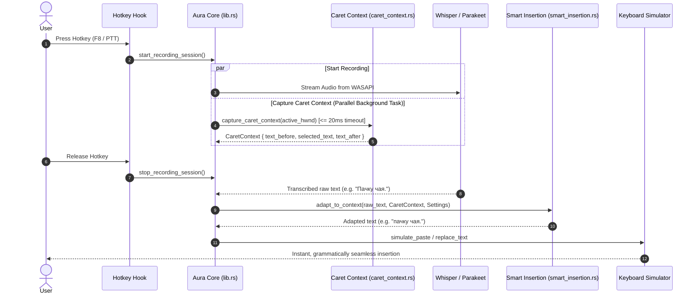

# Architecture Specification: Smart Context-Aware Dictation & Insertion (Aura 2.0)

**Date:** 2026-10-05  
**Status:** Approved by User  
**Target Release:** Aura v1.1.3  

---

## 1. Problem Statement & Motivation

In current speech-to-text engines (Whisper.cpp, Parakeet, Cloud ASR), speech segments are trained and formatted as standalone complete utterances. As a result:
1. Every recognized text fragment starts with a capitalized first character (e.g. `«Привет»`, `«Пачку чая»`).
2. Every segment ends with sentence-terminal punctuation (typically a period `.`, e.g. `«Пачку чая.»`).
3. Aura's current normalizer ([`text_normalizer.rs`](file:///g:/Aura/2.0/src-tauri/src/text_normalizer.rs#L616-L625)) unconditionally forces the very first character of the transcription to uppercase.
4. Aura's input simulator has no awareness of where the caret (cursor) is positioned in the target document or what text surrounds it unless a selection was copied via `Ctrl+C`.

When a user tries to dictate words into an existing sentence (e.g. cursor placed after `«Я пошел в магазин и купил »`, or in the middle `«Мы должны [курсор] встретиться завтра»`):
- The inserted text erroneously capitalizes the first letter (`«Пачку чая.»` / `«Как можно скорее.»`).
- A trailing period is inserted inside an unfinished sentence (`«Мы должны Как можно скорее. встретиться завтра»`).
- Spacing around the cursor often collides or is duplicated.

### Goal
Implement a lightning-fast, zero-latency, context-aware insertion system that detects whether speech is a **new sentence**, a **mid-sentence insertion**, an **append/continuation to an open sentence**, or an **edit/replacement**, automatically adapting letter case, trailing punctuation, and boundary whitespace.

---

## 2. Core Architectural Decisions

1. **Two-Layer Hybrid Architecture**:
   - **Layer 1 (Instant Deterministic Rules, <0.05 ms)**: Used for 100% of standard voice dictation. Uses native Windows UI Automation (UIA) to read surrounding text and applies deterministic casing/punctuation/spacing rules without calling any LLM.
   - **Layer 2 (Context-Enriched AI Edit)**: When a user selects text and speaks an edit command (e.g. «сократи», «переведи», «исправь»), the surrounding context (`text_before` and `text_after`) is passed into the prompt of the local Qwen3 or Cloud LLM so that grammatical agreement (gender, case, tense) matches the surrounding sentence.
2. **Zero-Latency Invariant**:
   - Querying Windows UI Automation runs **concurrently in a background thread** during recording as soon as the hotkey is pressed.
   - Context is already captured and waiting in memory before Whisper/ASR finishes transcribing.
   - UIA query has a strict **20 ms timeout**. If the active window does not support UIA or hangs, Aura falls back immediately to standard dictation without stalling.
3. **Zero Clipboard Pollution**:
   - UIA reads the caret context and existing selection directly through Windows Accessibility APIs without injecting synthetic `Ctrl+C` keystrokes or clearing clipboard formats.
4. **User Control (Option 3 Approved)**:
   - Mid-sentence insertions *always* strip trailing periods.
   - Sentence continuation at the end of an open line respects the user setting `smart_context_trailing_period` (enabled by default to complete the sentence with a period, but toggleable in settings).

---

## 3. Subsystem Architecture & Data Flow



---

## 4. Component Details

### 4.1. Caret Context Extractor: `caret_context.rs`
Located in `2.0/src-tauri/src/caret_context.rs`.

**Data Structures:**
```rust
#[derive(Clone, Debug, Default, PartialEq, Eq)]
pub struct CaretContext {
    pub text_before: String,
    pub selected_text: String,
    pub text_after: String,
    pub source: CaretContextSource,
}

#[derive(Clone, Copy, Debug, PartialEq, Eq, Default)]
pub enum CaretContextSource {
    #[default]
    None,
    UiaTextPattern,
    UiaValuePattern,
    Win32Edit,
    ClipboardFallback,
}
```

**Extraction Protocol:**
1. Call `CoInitializeEx(None, COINIT_MULTITHREADED)` (or utilize MTA pool).
2. Instantiate `IUIAutomation` via `CoCreateInstance(&CUIAutomation)`.
3. Query `GetFocusedElement(&mut element)`.
4. If element supports `IUIAutomationTextPattern`:
   - Call `GetSelection(&mut ranges)`.
   - If range exists:
     - Read `range.GetText(-1)` $\rightarrow$ `selected_text`.
     - Clone to `prefix_range`, call `prefix_range.MoveEndpointByUnit(TextPatternRangeEndpoint_Start, TextUnit_Character, -100)`, read text $\rightarrow$ `text_before`.
     - Clone to `suffix_range`, call `suffix_range.MoveEndpointByUnit(TextPatternRangeEndpoint_End, TextUnit_Character, 100)`, read text $\rightarrow$ `text_after`.
5. If element does not support `TextPattern`, check `IUIAutomationValuePattern`:
   - Read `get_CurrentValue(&mut val)` to detect if field is completely empty.
6. If UIA unavailable:
   - Check classic Win32 `EM_GETSEL` if window class is `Edit` or `RichEdit`.
   - Otherwise fallback gracefully to `CaretContextSource::None`.

### 4.2. Smart Insertion Classifier: `smart_insertion.rs`
Located in `2.0/src-tauri/src/smart_insertion.rs`.

**Classification Logic:**
```rust
#[derive(Clone, Copy, Debug, PartialEq, Eq)]
pub enum InsertionMode {
    NewSentence,
    MidSentenceInsertion,
    SentenceContinuation,
    SelectionReplacement,
}

pub fn classify_insertion_mode(ctx: &CaretContext) -> InsertionMode {
    if !ctx.selected_text.trim().is_empty() {
        return InsertionMode::SelectionReplacement;
    }

    let before_trimmed = ctx.text_before.trim_end();
    if before_trimmed.is_empty() {
        return InsertionMode::NewSentence;
    }

    let last_char = before_trimmed.chars().last().unwrap_or('\0');
    let is_terminal = matches!(last_char, '.' | '!' | '?' | '\n' | '\r' | '…');

    if is_terminal {
        InsertionMode::NewSentence
    } else {
        let after_trimmed = ctx.text_after.trim_start();
        if after_trimmed.is_empty() {
            InsertionMode::SentenceContinuation
        } else {
            InsertionMode::MidSentenceInsertion
        }
    }
}
```

**Transformation Rules:**
1. **Letter Case Rules:**
   - `NewSentence` $\rightarrow$ First char uppercase.
   - `MidSentenceInsertion` & `SentenceContinuation` $\rightarrow$ First char lowercase, **except** for:
     - Known uppercase acronyms (all-caps word with length >= 2, e.g. `API`, `США`, `GPU`, `HTTP`).
     - Words existing in user custom dictionary capitalized.
   - `SelectionReplacement` $\rightarrow$ If prefix ended with terminal punctuation, uppercase; otherwise lowercase.
2. **Trailing Punctuation Rules:**
   - `MidSentenceInsertion`: **Always strip** trailing period `.`. Keep `?` or `!` only if expressly spoken.
   - `SentenceContinuation`: If `smart_context_trailing_period == true`, keep period; if `false`, strip period.
   - `NewSentence`: Keep period.
   - Punctuation collision: If `text_after` begins with punctuation (e.g. `,`, `.`), never insert duplicate trailing punctuation.
3. **Boundary Whitespace Rules:**
   - **Leading space**: If `text_before` does NOT end with whitespace or newline, and `text_before` is not empty:
     - Prepend a space `" "` to avoid gluing words together.
   - **Trailing space**: If `MidSentenceInsertion` and `text_after` does NOT begin with whitespace or punctuation:
     - Append a space `" "` to ensure clean insertion between existing words.

### 4.3. Pipeline Integration in `lib.rs`
- In `start_recording_session`:
  - Launch background task `capture_caret_context`.
  - Store handle in `state.caret_context`.
- In transcription completion handler (lines ~3960–4010):
  - If `settings.smart_context_enabled`:
    - Apply `smart_insertion::adapt_text(&transcribed, &caret_context, &settings)`.
  - Pass adapted text to `keyboard_simulator::simulate_paste` or `diff_and_type`.
- In LLM Edit Pass (lines ~3740–3920):
  - Pass `CaretContext` into `llm_runner::run_local_edit` and `ai_client::edit_text_with_provider` as supplementary context.

---

## 5. Settings & UI Schema

### Backend Settings: `settings_secure.rs`
```rust
#[derive(Debug, Clone, Serialize, Deserialize)]
pub struct Settings {
    // ... existing fields ...
    #[serde(default = "default_true")]
    pub smart_context_enabled: bool,

    #[serde(default = "default_true")]
    pub smart_context_trailing_period: bool,
}
```

### Frontend UI: `src/index.html` & `src/main.js`
In the **«Текст» (Text)** tab, add a new card or expand formatting controls:
- Master toggle: **«Умная контекстная вставка»** (`#toggle-smart-context`).
  - Label description: *«Адаптирует регистр и знаки препинания под курсор: начинает со строчной буквы в середине фразы и убирает лишние точки»*.
- Sub-toggle: **«Завершать точкой при дополнении в конце предложения»** (`#toggle-smart-context-trailing-period`).
  - Shows when `#toggle-smart-context` is checked.
- Localized into all 10 languages (`ru`, `en`, `de`, `es`, `fr`, `it`, `zh`, `pt`, `tr`, `nl`).

---

## 6. Verification & Quality Gates

1. **Rust Unit Tests**:
   - `test_classify_new_sentence_empty`
   - `test_classify_new_sentence_after_dot`
   - `test_classify_new_sentence_after_newline`
   - `test_classify_mid_sentence_insertion`
   - `test_classify_sentence_continuation`
   - `test_classify_selection_replacement`
   - `test_adapt_mid_sentence_lowercases_and_strips_period`
   - `test_adapt_mid_sentence_adds_boundary_spaces`
   - `test_adapt_preserves_acronyms` (`API`, `США`)
   - `test_adapt_continuation_respects_trailing_period_setting`
   - `test_adapt_no_punctuation_duplication`
2. **Fail-safe Timeout Gate**:
   - Verification that UIA execution terminates cleanly within 20ms and returns `None` on unresponsive windows.
3. **Frontend Static Gates**:
   - `npm test` (verify all 10 locales have matching keys for new settings).
   - `npm run check` (TypeScript / ESLint).
4. **Visual Pre-flight Check**:
   - Verify layout and aesthetics of the new settings controls in the «Текст» tab via CDP screenshot.
